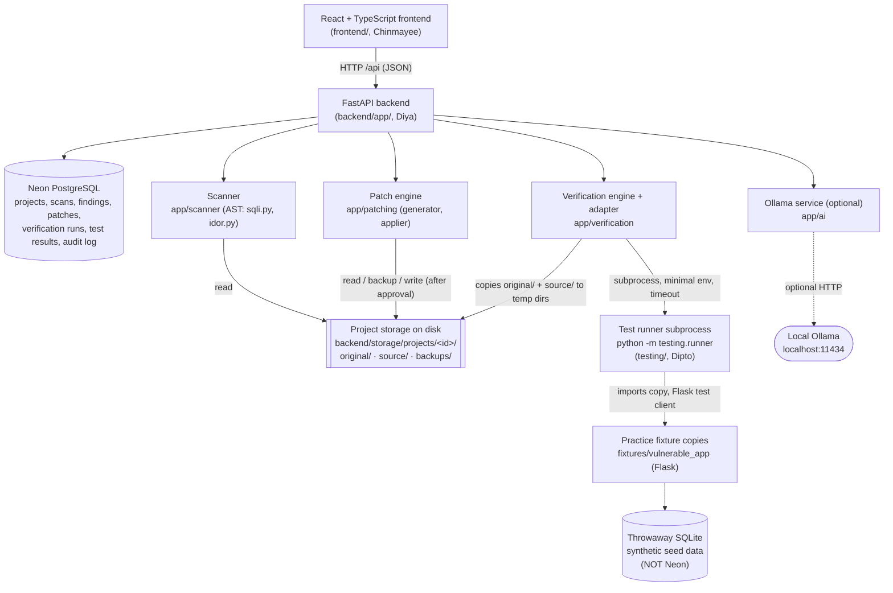

# PatchProof Architecture

## Components

| Component | Location | Responsibility |
|---|---|---|
| Frontend | `frontend/` | All UI. Talks only to `/api`. Has a clearly-bannered mock mode |
| API routes | `backend/app/routes/` | Validation, orchestration, persistence, error format |
| Scanner | `backend/app/scanner/` | AST-based detection of supported SQLi and IDOR patterns, with evidence |
| Patch engine | `backend/app/patching/` | Deterministic patch generation, static validation, apply with backup, rollback |
| Verification | `backend/app/verification/` | Makes isolated copies, invokes the runner, validates its output, stores results, accepts or rejects |
| AI | `backend/app/ai/` | Optional explanations via local Ollama. Advisory only |
| Reports | `backend/app/reports/` | JSON and HTML verification reports from stored results |
| Test runner | `testing/` | Exploit and regression tests, PrivilegeMap, verdict rules, JSON output |
| Fixtures | `fixtures/` | Deliberately vulnerable Flask app, synthetic seed SQL, reference variants |

## Data flow: the full Proof-of-Fix workflow

1. **Create a project.** `POST /projects` copies `fixtures/vulnerable_app` into `storage/projects/<id>/original/` (never modified) and `source/` (the working copy). A row is added to `projects`.
2. **Scan.** `POST /scans` parses every `.py` file in `source/` with Python's `ast` module. Each detector returns findings with file, lines, snippet, structured evidence, severity and rationale. Rows are added to `scans` and `findings`.
3. **Baseline replay (optional).** `POST /verification/run {project_id, scenario}` copies `original/` into a temp dir and runs `python -m testing.runner --phase baseline`. The result shows whether the exploit really works.
4. **Generate a patch.** `POST /patches/generate` re-parses the current file, builds a minimal line-range replacement, produces a unified diff, and re-scans the patched text in memory (a static check). A `patches` row is created with status `PROPOSED`. Disk is untouched.
5. **Approve and apply.** `POST /patches/{id}/apply {approved: true, approved_by}` checks that the exact original lines are still present, backs up the file to `backups/<patch_id>/`, writes the change atomically, and sets status `APPLIED`. An audit log entry is written.
6. **Proof-of-Fix.** `POST /verification/run {patch_id}` copies `original/` to `tmp/before` and `source/` to `tmp/after`, then runs the runner in compare mode. The runner seeds a fresh SQLite database for each phase, runs the same exploits and regression tests on both copies, and computes the verdict. The backend validates the JSON, stores every test result, and sets the patch to `VERIFIED` or `REJECTED`.
7. **Report.** `GET /reports/{run_id}?format=html|json` assembles the stored evidence.
8. **Rollback.** `POST /patches/{id}/rollback` reverses exactly that patch's lines, leaving other applied patches intact.

## Key design decisions

- **The verdict comes only from executed tests.** The runner's rules in `testing/verdict.py` are deterministic. The backend stores and acts on the verdict but never upgrades it. AI is not in this path.
- **The test logic has one owner.** The backend calls the runner's CLI and does not import `testing/`. This keeps Diya's and Dipto's code independent and lets the runner be tested on its own.
- **Uploads are never executed.** Only bundled fixtures, whose behaviour the runner knows, are verified. Uploaded ZIPs are scanned and can be patched, and the UI explains why they can't be verified.
- **Static re-scans are not proof.** The deny-all demo patch passes the static re-scan but fails Proof-of-Fix, which is the core demonstration.
- **Two separate databases.** Neon holds PatchProof's own records. The vulnerable app's SQLite file is synthetic, created per test phase in a temp dir, and deleted afterwards.
- **No queues or workers.** Scans and verifications are synchronous: they take under a second on the fixture, which suits a 24-hour hackathon.

## Trust boundaries

1. **Browser → API.** Inputs are validated by Pydantic. There is no authentication (this is a local demo tool; see [threat_model.md](threat_model.md)).
2. **API → uploaded files.** Uploads are untrusted data. They are safely extracted, never imported or executed, and secret files are dropped.
3. **API → test runner.** This is a separate process with a minimal environment (no secrets), a timeout and resource limits. It receives copies of the code only.
4. **Runner → fixture app.** The fixture is trusted, team-authored code. It runs in-process in the runner with network access blocked.
5. **API → Ollama.** Output is untrusted text. It is length-capped, labelled advisory, and never parsed into actions.
6. **API → Neon.** Uses TLS (`sslmode=require`). Credentials come only from the environment.

## Static analysis scope (what the scanner understands)

**SQL injection (CWE-89):** `.execute()`, `.executemany()` or `.executescript()` where the SQL argument (inline, or a local variable assigned in the same function) is built with an f-string, `+` concatenation, `+=`, `%`-formatting or `.format()`, *and* its literal text contains SQL keywords. Interpolated variables are traced one assignment back to `request.*` or URL path parameters to set confidence and severity. Auto-patching supports f-string and `+` concatenation, including values inside quoted literals such as `LIKE '%{x}%'`.

**IDOR (CWE-639):** Flask-style route decorators (`.route/.get/.post/...`) with a URL path parameter that is passed to a lookup call, with **none** of the following: an access-check helper call (`can_*`, `*authori[sz]*`, `*permission*`, `has_access`, …), an authorisation decorator, an ownership comparison (`owner*`, `user_id`, `author*`, `created_by`), an ownership-filtered query, or an unconditional `abort(401/403)`. Auto-patching inserts a call to an existing two-argument access-check helper in the same module.

Anything outside these patterns is not detected. The README's limitations section says so plainly.
